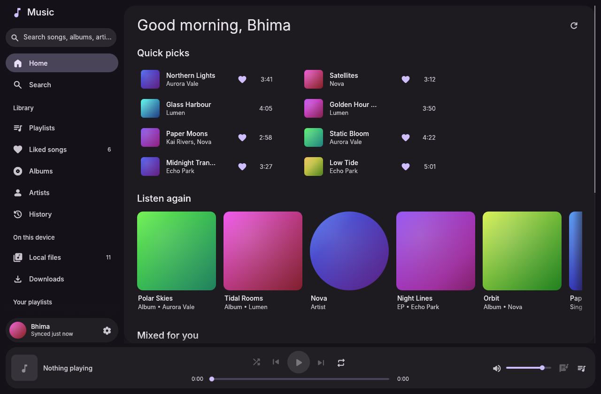
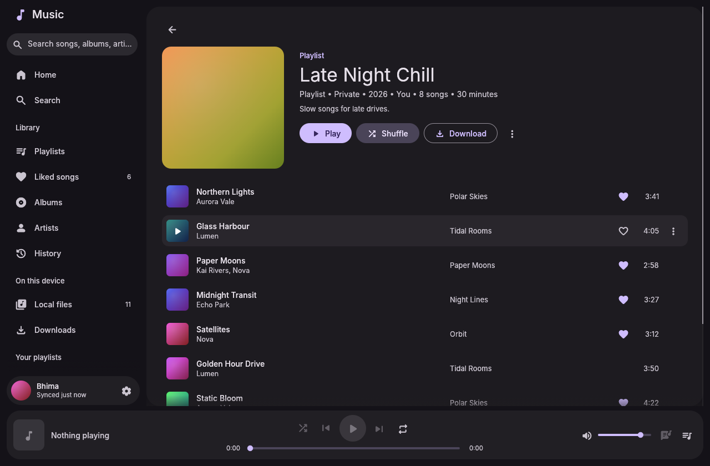
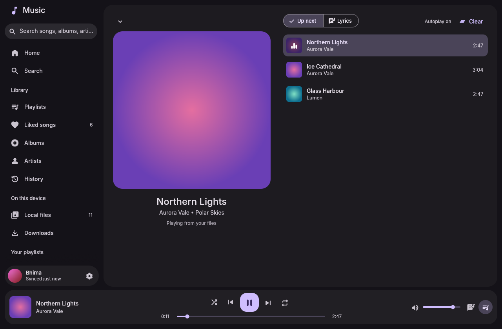
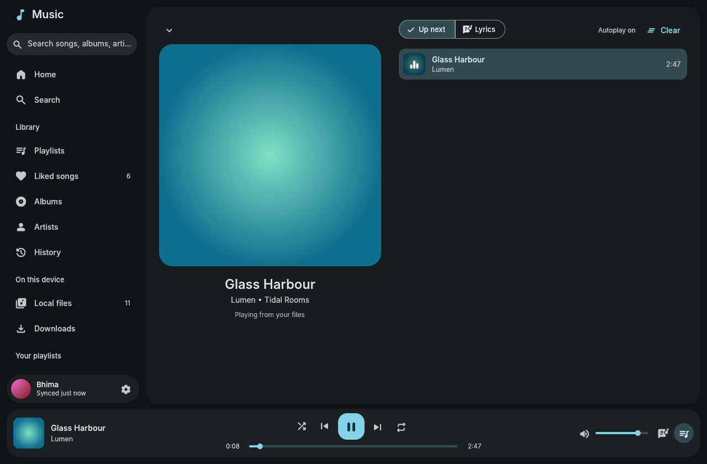

# Material 3 Music

A YouTube Music client and local music player for Linux, built with [egui](https://github.com/emilk/egui) and themed with Material You. It looks and behaves like the [Material 3 File Manager](https://github.com/bhimio1/material-3-file-manager-rust) and [Material 3 Settings](https://github.com/bhimio1/material-3-settings), and on an end-4 / end4-pC desktop it takes its colors from your wallpaper.






## Features

**YouTube Music**
- Home shelves (quick picks, mixes, listen again), search with suggestions and Songs / Videos / Albums / Artists / Playlists filters.
- Album, playlist and artist pages with Play, Shuffle, Radio and Download. Long playlists load as you scroll.
- Lyrics, and "Start radio" from any song. When the queue runs out, related songs keep playing (Autoplay, can be turned off).

**Sign in and sync**
- Two ways to sign in, see [Signing in](#signing-in).
- Your library (playlists, liked songs, albums, subscribed artists and history) is synced when the app starts and every 30 minutes, or with **Sync now**.
- The library is cached on disk, so it shows instantly and offline. If one section fails to sync, its last good copy is kept.
- Changes go to your account straight away and show in the app immediately. If YouTube Music refuses one, it's undone and you get a message. This covers liking songs, creating playlists, and adding songs to or removing them from your playlists.
- Search and playback work without an account.

**Local files**
- Scans your music folders (`~/Music` by default; add more in Settings) and reads tags and embedded cover art with [lofty](https://github.com/Serial-ATA/lofty-rs).
- Songs, Albums and Artists views with sorting and filtering. Changes on disk are picked up automatically.
- Results are cached, so rescans only re-read files that changed.

**Downloads**
- Download a song, album, playlist or all your liked songs with [yt-dlp](https://github.com/yt-dlp/yt-dlp). Files are saved as Opus, M4A or MP3, with metadata and cover art embedded, into `~/Music/M3 Music/<Artist>/<Album>/`.
- Progress bars, cancel, retry, and a limit on simultaneous downloads.
- Downloaded songs are recognised everywhere (✓ badge) and play from disk, so they work offline. **Remove download** deletes the file.

**Playback**
- Plays through [mpv](https://mpv.io) over its JSON IPC: gapless local playback, and YouTube streams through yt-dlp. With a browser-session sign-in, your cookies are passed along, so songs that need an account play too.
- Queue with play next / add to queue, reorder and remove. Shuffle (and back to the original order), repeat all / one.
- **MPRIS** (`org.mpris.MediaPlayer2.m3music`), so the end4-pC media widgets, `playerctl` and media keys show and control it.
- Keyboard:
  - <kbd>Space</kbd> play/pause
  - <kbd>Ctrl</kbd>+<kbd>←</kbd> / <kbd>→</kbd> previous/next
  - <kbd>Ctrl</kbd>+<kbd>F</kbd> search
  - <kbd>Alt</kbd>+<kbd>←</kbd> or the mouse back button: back

**Appearance**
- **Desktop** colors: the end-4 / end4-pC shell's generated `colors.json`, live-reloaded when the wallpaper changes.
- **Album art**: the palette follows the cover of the song that's playing.
- **Seed**: a color you pick. Plus light/dark/system, filled or outlined icons, and interface scale.

## Signing in

### Browser session (quickest)

1. Open [music.youtube.com](https://music.youtube.com) in your browser, signed in.
2. Open developer tools (F12) → **Network**, and click any request to `browse` (scroll the page if there are none).
3. Copy its **request headers**. In Firefox use *Copy Request Headers*; in Chrome copy the request-headers section. Copying just the `Cookie` value also works.
4. In Material 3 Music: **Settings → Account → Use your browser session**, paste, and press **Sign in with browser session**.

Requests are signed the same way the website signs them, with a `SAPISIDHASH` derived from your `SAPISID` cookie. The session lasts until you sign out of YouTube in that browser.

### Sign in with Google (OAuth)

This uses the OAuth *device flow*, with a client from your own Google Cloud project. No credentials are built into the app.

1. In the [Google Cloud console](https://console.cloud.google.com/), create a project.
2. **APIs & Services → Library**: enable **YouTube Data API v3**.
3. **OAuth consent screen**: choose *External* and add your Google account as a test user.
4. **Credentials → Create credentials → OAuth client ID**, with type **TVs and Limited Input devices**.
5. In Material 3 Music: **Settings → Account**, paste the client ID and secret, and press **Sign in with Google**. Open `google.com/device` and enter the code shown (it's already on your clipboard).

Tokens refresh automatically.

Credentials are stored in `~/.local/share/m3-music/auth.json`, readable only by you. Signing out deletes them.

## Install

Runtime requirements: **mpv** and **yt-dlp**. The app offers to install them if they're missing.

Prebuilt x86_64 binaries are attached to [releases](https://github.com/bhimio1/material-3-music/releases) (push a `v*` tag to publish one).

From the AUR, prebuilt or built from source:

```sh
paru -S material-3-music-bin   # or material-3-music-git
```

On Arch, with the included PKGBUILD:

```sh
cd packaging
makepkg -si
```

Or build directly:

```sh
cargo build --release
./target/release/m3-music [FILE_OR_URL…]
```

Files and `music.youtube.com` / `youtube.com` / `youtu.be` links given on the command line start playing straight away.

## Configuration

Settings are edited in the app and stored in `~/.config/m3-music/config.toml`:
- library folders;
- download format, folder and parallel downloads;
- sync interval;
- autoplay;
- extra mpv options (`mpv_args`, e.g. `["--af=loudnorm"]`);
- theme.

Data lives in these places:
- `~/.local/share/m3-music`: account, synced library, download index.
- `~/.cache/m3-music`: thumbnails, local-library index, extracted covers.

## Project layout

```
src/
  app.rs          app state, theme, layout, shortcuts, action dispatch
  yt/             InnerTube client: auth (OAuth device flow, browser
                  session), JSON helpers, parsers, model
  library.rs      synced library: cache, background sync, optimistic edits
  player/         queue/shuffle/repeat/radio, mpv IPC, MPRIS server
  local.rs        local library scan (lofty) and file watching
  downloads.rs    yt-dlp download queue and offline index
  thumbs.rs       cover art loading, disk cache, texture LRU, seed colors
  theme/          M3 palette → egui style (shared with the other apps)
  ui/             sidebar, now-playing bar, track lists and cards, pages
fixtures/         trimmed InnerTube responses used by the tests
```

Run the tests with `cargo test`.

For development without a network, `M3_MUSIC_FIXTURES=fixtures` answers API requests from the JSON in `fixtures/`, and `M3_MUSIC_PAGE` opens a page at start (`home`, `search:<query>`, `detail:<id>`, `liked`, `local`, `downloads`, `settings`, `now`).

## License

MIT, see [LICENSE](LICENSE).

Fonts: Inter (SIL OFL 1.1, see `assets/fonts/LICENSE-Inter.txt`). Icons: Material Symbols, via `egui_material_icons`.
